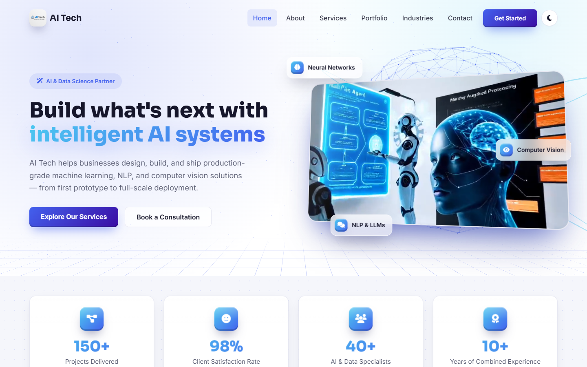
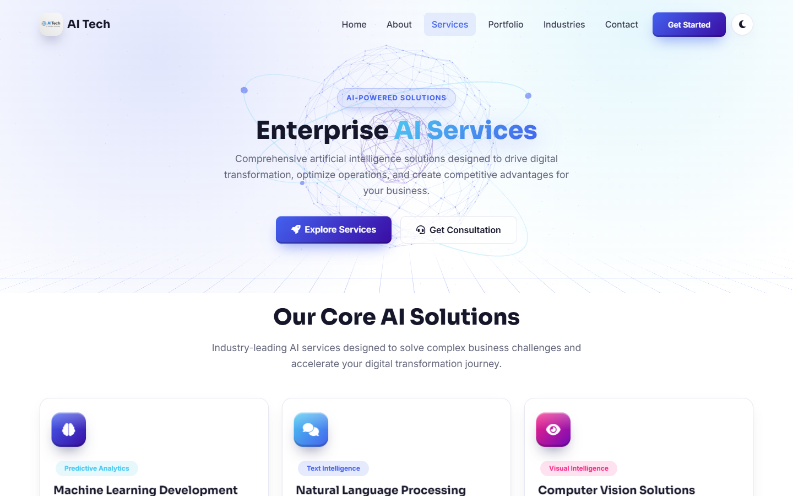
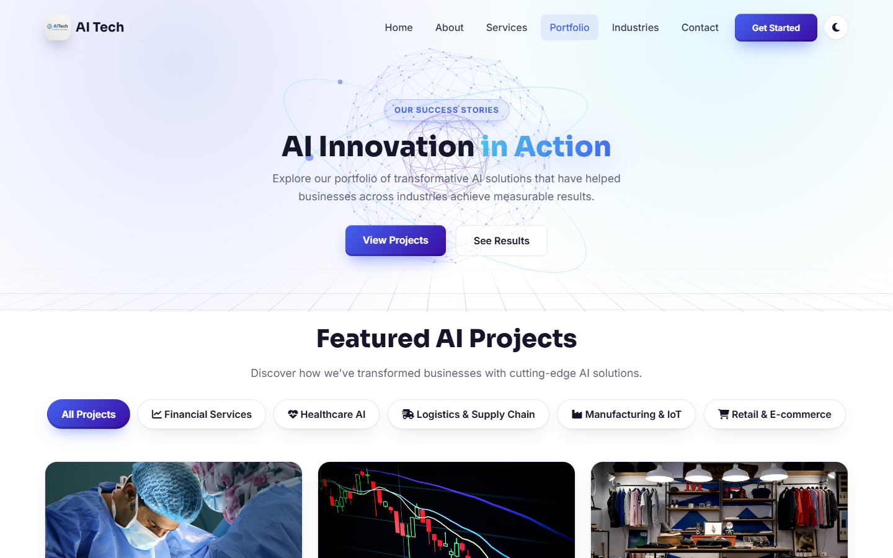
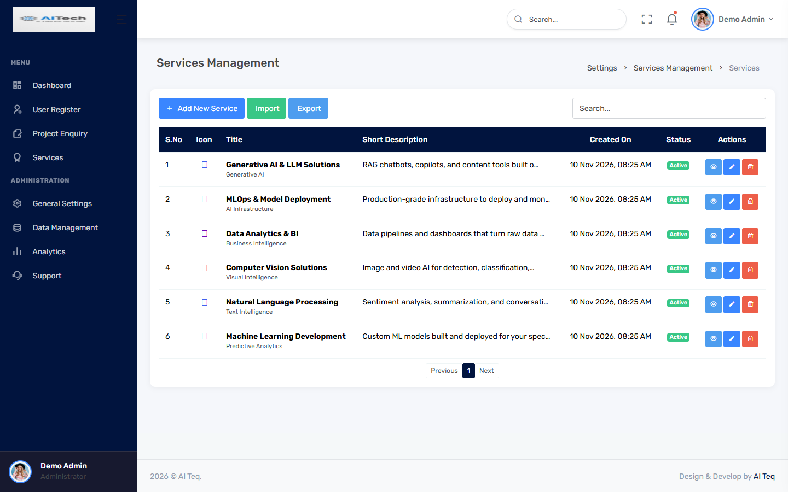
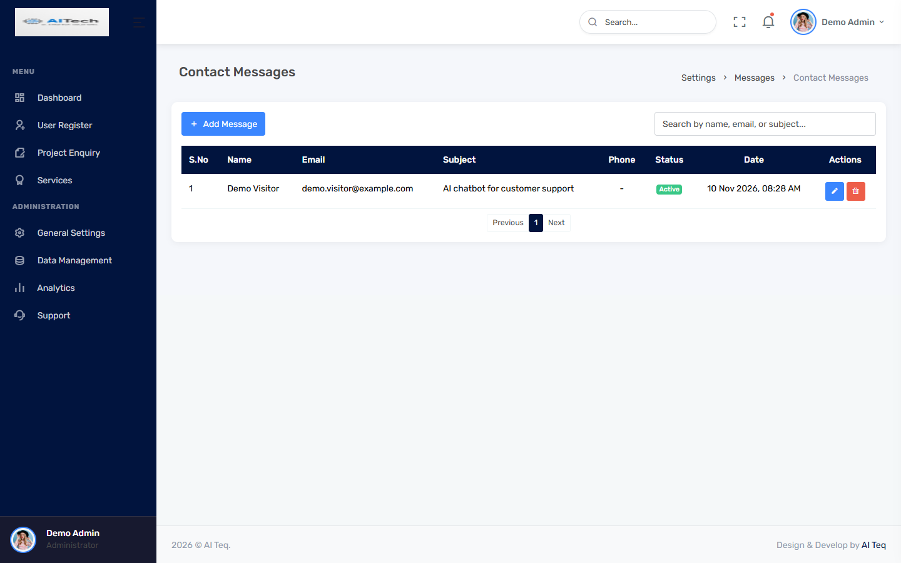

# AI Tech: company website with an admin console

A Django website for an AI and data-science services company, with its own admin console. Staff use the console to manage the site's content: services, portfolio projects, testimonials, statistics and contact details. They also see the enquiries that visitors send.



## Features

**Public website**
- Home, About, Services, Portfolio, Industries and Contact pages, all rendered from the database.
- A 3D hero section built with Three.js (WebGL), plus tilt cards, scroll animations and pointer effects.
- Light and dark themes. The site follows the visitor's system setting and remembers their choice.
- A detail page for each service. The portfolio filters by category and has project detail pages with image galleries.
- Contact and consultation forms that save enquiries for the admin console.
- Responsive layout for phones, tablets and desktops.

**Admin console** (`/aiteqadmin/`)
- Separate console sign-in and sign-up, with hashed passwords and a one-hour session timeout.
- Create, edit, delete and activate or deactivate: services, supporting services, project categories, portfolio projects, testimonials and result statistics.
- Review and manage contact messages and consultation requests.
- Edit the company contact details shown on the website.
- Services and supporting services: export a date-range report as **PDF** or **CSV**, and bulk-import from **CSV**.
- Search and pagination on the management lists.

## Screenshots

Screenshots of the running app, with demo content from `python manage.py seed_demo_data`. The client names and portfolio photos (free-licence Unsplash images) are demo data.

| Services | Portfolio |
|---|---|
|  |  |
| **Admin: services management** | **Admin: contact messages** |
|  |  |

## Tech stack

Python · Django 5.2 · MySQL · Bootstrap 5 · JavaScript · Three.js · xhtml2pdf

## Run it locally

You need Python 3.11 and a running MySQL server.

1. Create the database in MySQL:

   ```sql
   CREATE DATABASE aitech;
   ```

2. Install the dependencies:

   ```bash
   python -m venv venv
   venv\Scripts\activate        # Windows
   # source venv/bin/activate   # macOS / Linux
   pip install -r requirements.txt
   ```

3. Copy `.env.example` to `.env`, then fill in `SECRET_KEY`, `DATABASE_PASSWORD` and `FERNET_KEY`. Each one has a comment in the file showing how to generate it.

4. Create the tables, load the demo content and start the server:

   ```bash
   python manage.py migrate
   python manage.py seed_demo_data
   python manage.py runserver
   ```

5. Open http://127.0.0.1:8000 for the website. For the admin console, open http://127.0.0.1:8000/aiteqadmin/console_signin/ and use **Signup** to create a console account.

## Project structure

```
AI_Tech/       Django project settings and URLs
aitech/        Public website: models, views, templates, demo-data command
aiteqAdmin/    Admin console: views and templates for managing the site
static/        CSS, JavaScript (including the 3D effects) and images
docs/          README screenshots
```

## Security

Secrets are read from the `.env` file, which is git-ignored. Never commit a real `.env` file. `DEBUG` is off unless you turn it on in `.env`, and `ALLOWED_HOSTS` comes from the environment.
